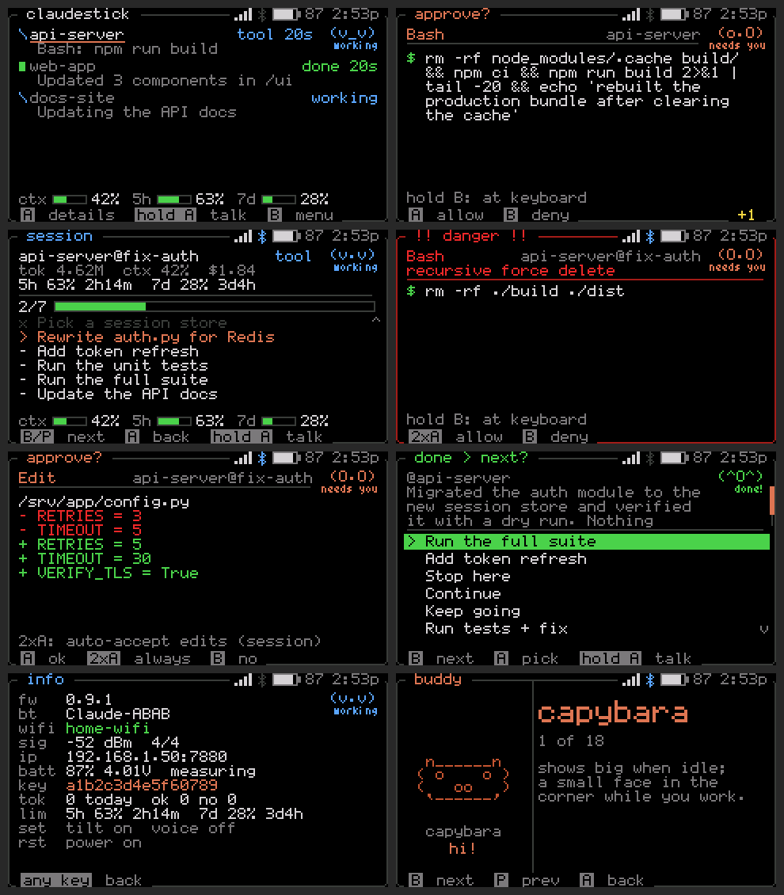
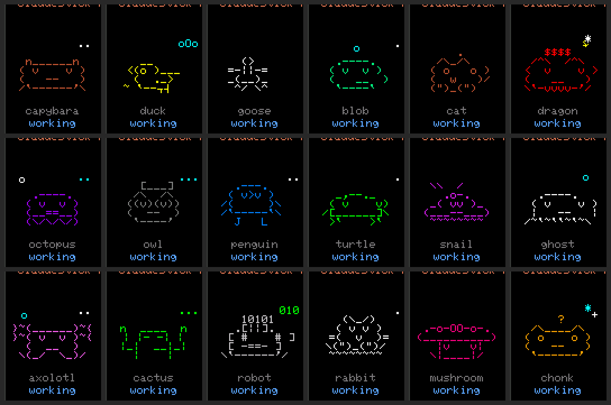

<div align="center">

# ClaudeStick

**A pocket-size handheld for Claude Code.**<br>
Approve tool calls with a button, watch every session, talk to Claude, and keep an eye on your plan limits, without going back to the terminal.

[**Flash it**](https://soupscode.github.io/ClaudeStick-S3/) &nbsp;·&nbsp; [How to use](docs/HOW_TO_USE.md) &nbsp;·&nbsp; [Away from home](docs/REMOTE.md) &nbsp;·&nbsp; [Troubleshooting](docs/TROUBLESHOOTING.md)



</div>

Runs on the **M5Stack StickS3**. Works with the `claude` CLI on any machine on your network and with the Claude desktop app over Bluetooth.

> **Early release.** Feature-complete and covered by an automated test suite plus a real firmware build in CI, but still being validated on StickS3 hardware. [Open an issue](../../issues) if something misbehaves.

## What it does

- **Approvals.** Every permission prompt lands on the Stick: allow, deny (even by voice, with a reason), or *always allow* with a rule that fits. Dangerous commands get a red card.
- **Live status.** One row per Claude session, with its to-do progress, context fill, 5-hour and 7-day plan limits, and a little buddy that reacts to what's happening.
- **Macros and questions.** One-button "Continue", "Next phase", "Run tests + fix", your own. Claude's multiple-choice questions become buttons.
- **Push-to-talk.** Hold a button, speak, confirm; the text goes to Claude.
- **Away from home.** A small bridge relays your sessions, so the Stick or your phone works from the office or a phone hotspot.
- **Phone page and alerts.** The same controls in a web page, plus [ntfy](https://ntfy.sh) pushes with Approve / Deny buttons.
- **Stays current.** New versions arrive over Wi-Fi with a changelog, install in one press, and roll back on their own if a build won't boot.



## Install

**You need:** an M5Stack **StickS3** (K150) and a USB-C **data** cable, desktop **Chrome or Edge** for flashing, and **Python 3** on each machine where you run `claude`.

1. **Flash.** Open the [web flasher](https://soupscode.github.io/ClaudeStick-S3/) (a fork publishes its own at `https://<owner>.github.io/<repo>/`), click **Install** and accept *erase*, then **Connect to Wi-Fi**. No computer handy? A fresh Stick opens a hotspot called `ClaudeStick-XXXX`; join it from your phone.
2. **Set up.** Open the page the flasher links to (`http://<stick-ip>:7880/setup`): time zone (detected), a name, a buddy, volume. Most settings live on that page; the Stick's own menu has the everyday toggles.
3. **Connect your machines.** The last step prints one command with your address and token filled in. Run it on every machine where you use `claude`:

   ```bash
   curl -s http://<stick-ip>:7880/install.py | python3 - --host <stick-ip> --port 7880 --token <token>
   ```

   It backs up `~/.claude/settings.json`, adds its hooks next to yours, keeps any status line you have, and is safe to re-run. `--test` checks the connection, `--uninstall` removes everything it added.
4. **Claude desktop app** *(optional)*. Help → Troubleshooting → Enable Developer Mode → Developer → Open Hardware Buddy… → Connect, pick your Stick, enter the 6-digit code it shows.

Then trigger an approval in Claude Code. No hardware yet? `python3 tools/mock_device.py --token test123` serves the Stick's API, phone page and setup wizard on your machine.

## Documentation

| | |
|---|---|
| [How to use](docs/HOW_TO_USE.md) | Buttons, approvals, remote mode, sessions and usage, push-to-talk, phone page, settings, updates, battery |
| [Away from home](docs/REMOTE.md) | The bridge: run it at home, reach it from anywhere, phone hotspot, security |
| [Troubleshooting](docs/TROUBLESHOOTING.md) | Recovery, safe mode, serial commands, "you can't brick it" |
| [How it works](docs/HOW_IT_WORKS.md) | Architecture, hook events, HTTP API, updates and rollback |
| [Contributing](CONTRIBUTING.md) | Build, test, release, fork |
| [Security](SECURITY.md) | Trust model and reporting |

## Privacy

Nothing leaves your network except what you configure: update checks, voice audio and ntfy messages go only to the servers you set. The Stick and your machines talk over plain HTTP with a shared token, so keep the Stick on a network you trust; the [bridge](docs/REMOTE.md) adds HTTPS for use away from home. Details in [SECURITY.md](SECURITY.md).

## License and credits

MIT, see [LICENSE](LICENSE). `firmware/src/ble_bridge.*` and `firmware/src/buddies/*` come from [anthropics/claude-desktop-buddy](https://github.com/anthropics/claude-desktop-buddy) (MIT); `tinyfont.h` is derived from the 3x5 "Tom Thumb" font (BSD 3-clause). The web flasher uses [ESP Web Tools](https://github.com/esphome/esp-web-tools). Built on [M5Unified](https://github.com/m5stack/M5Unified), [M5GFX](https://github.com/m5stack/M5GFX) and [ArduinoJson](https://arduinojson.org).
